# Retail store tiering on Iowa liquor sales

[](https://github.com/demirreren/retail-tiering/actions/workflows/ci.yml)

A weekend learning project (October 2026): an end-to-end data pipeline and store-tiering
model on Iowa's public liquor sales data, which records every bottle sold to every licensed
store in the state since 2012.

**Stack:** Apache Airflow 3, pandas, Snowflake, dbt, XGBoost, SHAP, Claude tool calling, pytest,
GitHub Actions, Tableau Public. Python 3.12.

## Architecture

```mermaid
flowchart LR
    HUB["Iowa Data Hub<br/>one CSV zip per year, bulk only"]
    RAW[("RAW.LIQUOR_SALES")]
    SQ[("MARTS.STORE_MONTH<br/>MARTS.STORE_QUARTER")]
    ST[("MARTS.STORE_TIERS")]
    RISK[("MARTS.TIER_DROP_RISK")]
    TIERS["tiering/tiers.py<br/>composite score, tiers A/B/C, back-test"]
    MODEL["tiering/predict_drop.py<br/>XGBoost + SHAP, time split"]
    BOT["assistant/<br/>Claude + one read-only SQL tool<br/>32-question eval"]
    TAB["scripts/export_for_tableau.py<br/>CSV for Tableau Public"]
    subgraph DAG["Airflow DAG iowa_liquor_pipeline, monthly, retries then alerts"]
        direction LR
        EX["extract"] --> CS["check_schema<br/>23 columns"] --> TR["transform<br/>pandas, md5 line_key"] --> DQV["dq_volume"] --> LD["load<br/>MERGE by line_key"] --> DQF["dq_freshness"] --> DBT["dbt run + test<br/>21 tests"]
    end
    HUB --> EX
    LD --> RAW
    RAW --> DBT
    DBT --> SQ
    SQ --> TIERS --> ST
    ST --> MODEL --> RISK
    SQ --> BOT
    ST --> BOT
    RISK --> BOT
    SQ --> TAB
    ST --> TAB
    RISK --> TAB
```



## Headline numbers (all from real runs, see NOTES.md)

- 6,896,430 rows loaded for 2024 to Sep 2026, 2,487 stores; a full year loads in about 190 to 210 s on a laptop.
- A repeat run re-sends the 7-day overlap window (49,261 rows) and inserts 0. 21 of 21 dbt tests pass.
- The published 2024 and 2025 files contain whole months duplicated across file parts (563,819 and
  429,996 repeated rows). The pipeline drops exact repeats; a naive load would overstate 2024 by 21.8%.
- Tier A stores make 65.4% of all sales in the latest quarter (66.7% among tiered stores). 68.7% of stores keep
  their tier from one quarter to the next.
- Tier-drop model on held-out 2026 quarters: AUC 0.850 (XGBoost), 0.864 (logistic regression),
  0.666 for a "closest to the tier floor" rule. Precision in the riskiest 10%: 0.796 vs a 0.307 base rate.
- Copilot eval: 32 of 32 correct on the second run (the first run's two misses were defects in my own
  eval, fixed), one SQL query per question, median 5.2 s, $0.41 for the whole run on Claude Opus 5.5.

## The four phases, interview version

### Phase 1: pipeline (Airflow 3, pandas, Snowflake, dbt)

- **What it does.** Once a month the DAG downloads the current year's file from the Iowa Data Hub (bulk only:
  one zip per year, no filters), checks that the 23 columns are unchanged, cleans it with pandas, keeps rows
  newer than the watermark already in Snowflake (minus a 7-day overlap), and MERGEs them in by a content-hash
  key, so a re-run or a retry never duplicates. dbt then builds a staging view and the store-by-month and
  store-by-quarter marts and runs 21 tests. Three checks fail the run loudly: schema drift, file volume against
  the previous run, and freshness of the newest sale. A failed task retries twice, then writes to an alert log
  and pops a desktop notification.
- **The hard part.** The publisher's stated unique id is not unique: the 2026 file has 2,200 invoice-and-item
  pairs that repeat with different quantities, plus 14 exact duplicate rows. Worse, the 2024 and 2025 files
  contain whole months duplicated across file parts: 563,819 and 429,996 repeated rows, checked two ways.
  The md5 line key handles both: distinct lines get distinct keys, exact repeats collapse, and the MERGE skips
  keys it already has. A naive load would overstate 2024 by 21.8% and 2025 by 17.3%.
- **Verified result.** 6,896,430 rows for 2024 to September 2026 across 2,487 stores; a full year loads in
  about 190 to 210 s on a laptop. Re-running the 2026 file re-sends the 49,261 rows in the overlap window and
  inserts 0. 21 of 21 dbt tests pass.

### Phase 2: tiering and the tier-drop model (pandas, XGBoost, SHAP)

- **What it does.** Each quarter every store gets a composite score from percentile ranks of sales, growth,
  month-to-month consistency and product mix, weighted 40/20/20/20; tier A is the top 20%, B the next 30%,
  C the rest. Only stores active all three months are tiered. A back-test over 11 quarters measures how stable
  the tiers are. XGBoost then predicts which A and B stores drop a tier next quarter, trained on 2024 Q1 to
  2025 Q4 and tested on 2026 Q1 and Q2 (a time split, never a random one), and SHAP explains the drivers
  overall and for any single store.
- **Verified result.** 68.7% of stores keep their tier from one quarter to the next (65.4% to 75.7% by
  quarter); an A store stays A 66.5% of the time. On the held-out quarters: AUC 0.850 for XGBoost, 0.864 for
  logistic regression, 0.666 for a "closest to the tier floor" rule; precision among the riskiest 10% is 0.796
  for both learned models against a 0.307 base rate. 933 A and B stores are scored for 2026 Q3 and 360 are
  flagged at p >= 0.5.
- **The honest read.** XGBoost and a scaled logistic regression are within noise of each other on this data;
  both beat the simple rule by a wide margin. Growth is 20% of the score but the noisiest input, so it drives
  most of the churn, and the top SHAP driver is a high growth rank (one-quarter spikes revert). A next version
  would smooth growth over two quarters or lower its weight.

### Phase 3: the sales copilot (Claude tool calling)

- **What it does.** Claude answers questions like "which stores in Polk County dropped a tier between Q2 and
  Q3, and why?" by writing SQL and running it through one tool. Four layers keep it read-only, each enough on
  its own: a Snowflake user that holds a SELECT-only role, a statement check that rejects anything but a single
  SELECT (run on the SQL with string literals blanked out, so `next_change = 'drop'` passes and `DROP TABLE`
  does not), a 200-row cap, and a 30-second statement timeout. Writes sent as that user straight to Snowflake,
  bypassing the app, are blocked by Snowflake itself.
- **The eval.** 32 questions, each with the SQL that computes the right answer, graded deterministically:
  counts, dollar figures, store-id sets, keywords, a percentage, a yes/no, a year not in the data, a county not
  in Iowa, and two write requests it must refuse. Run 1 scored 30/32, and both misses were defects in the eval,
  not the assistant: a grader that demanded an exact set when the answer rightly named a runner-up, and a
  denominator I had defined the less natural way. Run 2: 32 of 32, 1.0 SQL query per question, median 5.2 s,
  $0.41 for the whole run on Claude Opus 5.5.

### Phase 4: tests, CI and the dashboard export

- 80 pytest tests cover the schema check, the content-hash keys and type casts, the SQL guardrail and the eval
  grader, none of them touching Snowflake or the API. GitHub Actions runs them plus `dbt parse` on every push.
  `scripts/export_for_tableau.py` writes the three marts to CSV for the Tableau Public dashboard described below.

## How the numbers were verified

Every figure in this README is copied from [NOTES.md](NOTES.md), the only place a number is allowed to
originate. For each one it records the date and the command or Airflow run that produced it, and where it
mattered, a second method: the duplicate-row counts were checked both with the pipeline's md5 line key and with
plain `sort | uniq -d` on the raw CSV, and the row counts after the backfill were read back from Snowflake
rather than taken from the loader's own log. Model scores come from a time split (older quarters to train,
2026 Q1 and Q2 to test). The eval's ground truth is SQL run against the marts, and the first run's two misses
are recorded there as eval defects with what changed. Resume bullets and interview answers use only what is
listed there.


## Tests and CI

```bash
.venv/bin/pytest        # 80 tests, no Snowflake or API access needed
```

- `tests/test_extract.py`: `check_schema` passes on the 23 expected columns and raises `SchemaDriftError` on a
  missing, renamed or added column, naming the file part.
- `tests/test_transform.py`: on a 5-row fixture, md5 line keys are deterministic and equal the md5 of the raw
  row text, exact duplicates share a key, numbers are cast, blank strings and unparseable values become NA, and
  store ids keep their leading zeros.
- `tests/test_sql_tool.py`: the read-only check accepts single SELECTs (keywords inside string literals
  included) and rejects writes, multiple statements, comments and unbalanced quotes, each with its reason.
- `tests/test_run_eval.py`: the grader for every question type in the eval set, including the leading-zero
  store-id rule and the first-store-named rule for single-answer questions.

CI (`.github/workflows/ci.yml`) runs on every push and pull request: pytest on Python 3.12 from
`requirements-test.txt` (the tests never import Airflow, so it is left out to keep runs short), and `dbt parse`
with placeholder credentials, which compiles the models, sources and tests without opening a connection.

## Tableau Public dashboard

Tableau Public cannot connect to Snowflake, so the dashboard is built from CSV exports of the three marts:

```bash
.venv/bin/python scripts/export_for_tableau.py
```

That writes three files under `data/exports/` (gitignored). Each one carries a `state` column set to Iowa,
which Tableau needs next to `county_name` to draw counties on a map.

| file | grain | rows |
|---|---|---|
| `store_tiers.csv` | one store, one quarter: sales, score inputs, tier, `next_tier`, `next_change` | 22,838 |
| `store_quarter.csv` | the same grain without the tiering columns (everything in it is also in `store_tiers.csv`) | 22,838 |
| `tier_drop_risk.csv` | latest quarter only, one tier A or B store: `p_drop`, `top_reasons` | 933 |

Suggested dashboard (build it in the free Tableau Public app, then File > Save to Tableau Public):

1. **Data.** Connect to `store_tiers.csv` and add `tier_drop_risk.csv` as a second data source. Set
   `store_id` to String in both (Tableau reads it as a number and drops the leading zeros), give
   `county_name` the geographic role County and `state` the role State, and make `quarter_start` a Date.
2. **Tier map by county.** A filled map of `county_name` (with `state` on Detail), coloured by the number
   of tier A stores, with `quarter_start` as a filter shown on the dashboard. Switching the colour to the
   share of tiered stores that are tier A shows which counties punch above their size.
3. **Tier transitions.** A highlight table with `tier` on Rows and `next_tier` on Columns, excluding blank
   values (the last quarter has no next quarter), text = count of rows, colour = Percent of Total computed
   across each row. Over all quarters it reproduces the transition matrix in `NOTES.md`; filtered to
   `quarter_start` = 2026-04-01 it shows the Q2 to Q3 moves alone.
4. **Top at-risk stores.** From `tier_drop_risk.csv`: horizontal bars of `p_drop` by `store_name`, sorted
   descending with a Top N filter (20 by `p_drop`), coloured by `tier`, and `county_name`, `margin` and
   `top_reasons` in the tooltip so the hover explains the score.
5. **Dashboard.** The three sheets, the quarter filter, and a filter action from the map (Dashboard >
   Actions > Filter, source: map, targets: the other two sheets) so clicking a county narrows everything.

Published link: to come.

## Run it

```bash
./setup.sh                       # two venvs: Airflow (.venv) and dbt (.venv-dbt)
.venv/bin/pytest                 # unit tests, no credentials needed
cp .env.example .env             # fill in your Snowflake account identifier
# in Snowsight, as ACCOUNTADMIN, run snowflake/setup.sql with your public key pasted in
scripts/airflow.sh standalone    # UI at http://localhost:8080; trigger iowa_liquor_pipeline
.venv/bin/python -m tiering.tiers
.venv/bin/python -m tiering.predict_drop
.venv/bin/python scripts/export_for_tableau.py   # three CSVs under data/exports/ for Tableau Public
# copilot: run snowflake/setup_reader.sql in Snowsight, add ANTHROPIC_API_KEY to .env, then
.venv/bin/python -m assistant.ask "Which stores in Polk County dropped a tier between 2026 Q2 and Q3, and why?"
.venv/bin/python -m assistant.run_eval
```

Snowflake login is a dedicated service user with key-pair auth: the private key stays in `.secrets/`
(gitignored), the public key goes into `snowflake/setup.sql`. No passwords anywhere in the repo.

## Layout

```
dags/        Airflow DAG
pipeline/    extract, transform, load, quality checks
dbt/         staging and mart models with tests
tiering/     composite score, tiers, back-test, tier-drop model
assistant/   read-only SQL tool, Claude agent, ask CLI, eval runner
evals/       32 questions with ground-truth SQL, computed answers, latest results
tests/       pytest suite and its 5-row CSV fixture
snowflake/   one-time account setup SQL (loader and reader users)
scripts/     wrappers that load .env and pick the right venv; the Tableau export
reports/     SHAP charts
.github/     CI workflow
NOTES.md     every number, with the run it came from
```

## Data

Iowa Liquor Sales, Iowa Data Hub (data.iowa.gov), CC BY 4.0. One dataset per year, bulk download only
(`https://idh-be.iowa.gov/api/v1/datasets/<id>/rows.csv`, 2026 = id 1263). Updated monthly.

## Next

- Build and publish the Tableau Public dashboard described above, and link it here.
- Smooth growth over two quarters in the tier score, or lower its weight, and re-run the back-test.
- Move the source's `loaded_at_field` into its config block (a dbt 1.12 deprecation warning seen in `dbt parse`).
