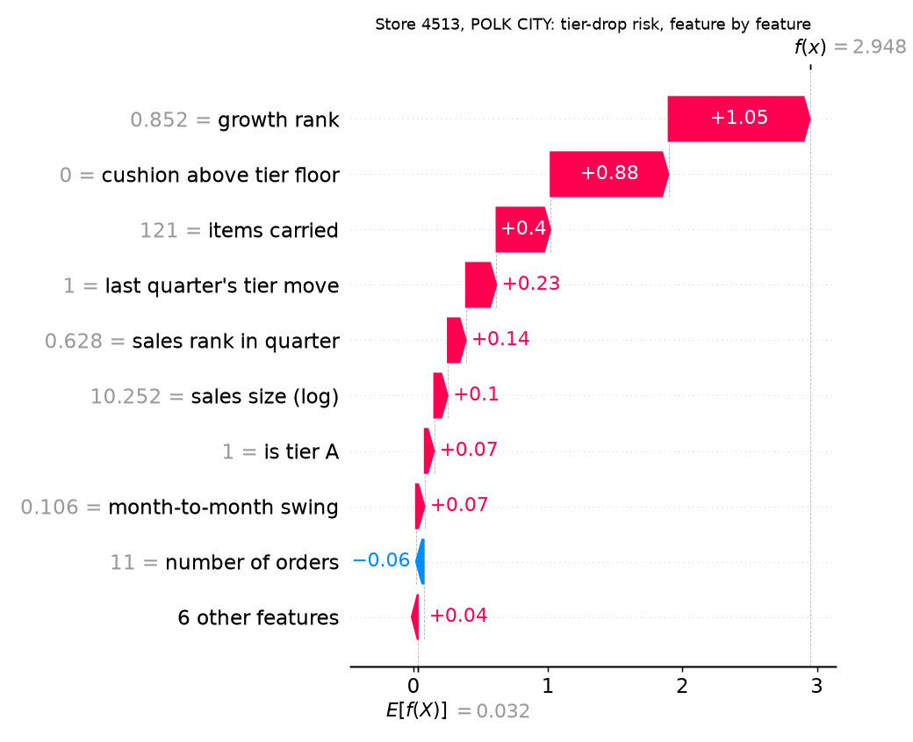

# Retail store tiering on Iowa liquor sales

A weekend learning project (October 2026): an end-to-end data pipeline and store-tiering
model on Iowa's public liquor sales data, which records every bottle sold to every licensed
store in the state since 2012.

**Stack:** Apache Airflow 3, pandas, Snowflake, dbt, XGBoost, SHAP. Python 3.12.

## What it does

1. **Pipeline (Airflow DAG `iowa_liquor_pipeline`).** Once a month: download the current year's file
   from the Iowa Data Hub, check the columns have not changed, clean it with pandas, keep only rows
   newer than what Snowflake already has, and MERGE them in by a content-hash key so re-runs never
   duplicate. Then dbt builds a staging view and store-by-month and store-by-quarter tables, and runs
   21 tests. Three data-quality checks fail the run loudly: schema drift, volume vs the previous run,
   and freshness of the newest sale. Failures retry twice, then write to an alert log and pop a
   desktop notification.
2. **Tiering (`tiering/tiers.py`).** Each quarter, every store gets a composite score: percentile ranks
   of sales, growth, month-to-month consistency, and product mix, weighted 40/20/20/20. Tiers: A = top
   20%, B = next 30%, C = the rest. A back-test over 11 quarters measures how stable the tiers are.
3. **Tier-drop model (`tiering/predict_drop.py`).** XGBoost predicts which A and B stores drop a tier
   next quarter, trained on older quarters and tested on newer ones. SHAP explains the drivers overall
   and for any single store. Scores for the latest quarter land in `MARTS.TIER_DROP_RISK`.
4. **Sales copilot (`assistant/`).** Claude answers questions like "which stores in Polk County dropped a
   tier between Q2 and Q3, and why?" by writing SQL and running it through one tool that can only read:
   a Snowflake user that holds a SELECT-only role, a check that rejects anything but a single SELECT,
   a 200-row cap, and a 30-second timeout. A 32-question eval (`evals/`) grades every answer against
   SQL-computed ground truth, including two write requests it must refuse and two questions the data
   cannot answer.

## Numbers (all from real runs, see NOTES.md)

- 6,896,430 rows loaded for 2024 to Sep 2026, 2,487 stores; first full-year load about 3 minutes on a laptop.
- A repeat run re-sends the 7-day overlap window (49,261 rows) and inserts 0. 21 of 21 dbt tests pass.
- The published 2024 and 2025 files contain whole months duplicated across file parts (563,819 and
  429,996 repeated rows). The pipeline drops exact repeats; a naive load would overstate 2024 by about 22%.
- Tier A stores make 65.4% of all sales in the latest quarter (66.7% among tiered stores). 68.7% of stores keep their tier from one quarter to the next.
- Tier-drop model on held-out 2026 quarters: AUC 0.850 (XGBoost), 0.864 (logistic regression),
  0.666 for a "closest to the tier floor" rule. Precision in the riskiest 10%: 0.80 vs a 0.31 base rate.
- Copilot eval: 32 of 32 correct on the second run (the first run's two misses were defects in my own
  eval, fixed), one SQL query per question, median 5 s, $0.41 for the whole run on Claude Opus 5.5.



## Run it

```bash
./setup.sh                       # two venvs: Airflow (.venv) and dbt (.venv-dbt)
cp .env.example .env             # fill in your Snowflake account identifier
# in Snowsight, as ACCOUNTADMIN, run snowflake/setup.sql with your public key pasted in
scripts/airflow.sh standalone    # UI at http://localhost:8080; trigger iowa_liquor_pipeline
.venv/bin/python -m tiering.tiers
.venv/bin/python -m tiering.predict_drop
# copilot: run snowflake/setup_reader.sql in Snowsight, add ANTHROPIC_API_KEY to .env, then
.venv/bin/python -m assistant.ask "Which stores in Polk County dropped a tier between 2026 Q2 and Q3, and why?"
.venv/bin/python -m assistant.run_eval
```

Snowflake login is a dedicated service user with key-pair auth: the private key stays in `.secrets/`
(gitignored), the public key goes into `snowflake/setup.sql`. No passwords anywhere in the repo.

## Layout

```
dags/        Airflow DAG
pipeline/    extract, transform, load, quality checks
dbt/         staging and mart models with tests
tiering/     composite score, tiers, back-test, tier-drop model
assistant/   read-only SQL tool, Claude agent, ask CLI, eval runner
evals/       32 questions with ground-truth SQL, computed answers, latest results
snowflake/   one-time account setup SQL (loader and reader users)
scripts/     wrappers that load .env and pick the right venv
reports/     SHAP charts
NOTES.md     every number, with the run it came from
```

## Data

Iowa Liquor Sales, Iowa Data Hub (data.iowa.gov), CC BY 4.0. One dataset per year, bulk download only
(`https://idh-be.iowa.gov/api/v1/datasets/<id>/rows.csv`, 2026 = id 1263). Updated monthly.

## Next

A Tableau Public dashboard, unit tests, and CI.
