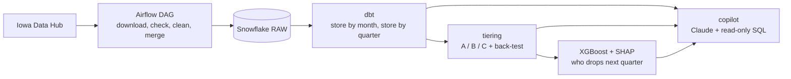

# retail-tiering

Store tiering and a sales copilot built on Iowa's public liquor sales data

[](https://github.com/demirreren/retail-tiering/actions/workflows/ci.yml)

I wanted to actually use Airflow, Snowflake, dbt and XGBoost on something real instead of just reading about them, so I built this over a weekend in October 2026. Iowa publishes every bottle of liquor sold to every licensed store in the state, which makes it a pretty good stand-in for the kind of point-of-sale data a sales team would use to tier its accounts.

## What it does

- A monthly Airflow DAG pulls the current year's file from the Iowa Data Hub, cleans it with pandas and merges only the new rows into Snowflake
- dbt turns the raw rows into store-by-month and store-by-quarter tables, with 21 tests on top
- Every store gets a tier each quarter: A for the top 20%, B for the next 30%, C for the rest
- An XGBoost model predicts which A and B stores will drop a tier next quarter, and SHAP explains why for any single store
- A copilot answers questions like "which stores in Polk County dropped a tier and why" by writing SQL through a tool that can only read
- A 32 question eval checks the copilot's answers against answers computed in SQL



## Numbers

All of these come from real runs. Every one is in [NOTES.md](NOTES.md) with the run that produced it.

- 6,896,430 rows loaded for 2024 to Sep 2026 across 2,487 stores, a full year loads in about 3 minutes on my laptop
- Re-running a file inserts 0 rows, the MERGE skips everything it already has
- Tier A stores make 65.4% of all sales in the latest quarter, and 68.7% of stores keep their tier from one quarter to the next
- Tier-drop model: 0.85 AUC on held-out 2026 quarters, vs 0.67 for a "closest to the tier floor" rule
- Copilot eval: 32/32 on the second run, one SQL query per question, $0.41 for the whole run


## Things I ran into

- Iowa moved off Socrata this year and the new API is bulk only, so the incremental part has to happen in the pipeline: a watermark with a 7 day overlap and a MERGE on an md5 of each row
- The dataset's "unique id" isn't unique, so that md5 line key is the real key
- The 2024 and 2025 files have whole months duplicated across the CSV parts, 563,819 and 429,996 repeated rows. I checked it two ways. A naive load would overstate 2024 by about 22%
- Airflow's DAG processor kept crashing on macOS until I moved the heavy imports inside the tasks and set `OBJC_DISABLE_INITIALIZE_FORK_SAFETY`
- Logistic regression matched XGBoost, 0.86 vs 0.85 AUC. The features matter more than the model here
- Growth is 20% of the tier score but it's the noisiest input, so it drives most of the churn. I'd smooth it over two quarters next time
- The first eval run was 30/32 and both misses were bugs in my eval, not the copilot. It also caught a guardrail bug on its very first query, the word `drop` inside a string literal was getting rejected

## How the copilot stays read-only

- It logs in as a separate Snowflake user that only holds a SELECT role on the mart tables
- A check rejects anything that isn't a single SELECT before it reaches Snowflake
- Every query is capped at 200 rows and 30 seconds
- I logged in as that user and tried UPDATE, DELETE and CREATE directly. Snowflake blocked all three

## Run it

```bash
./setup.sh                       # two venvs: Airflow (.venv) and dbt (.venv-dbt)
.venv/bin/pytest                 # 80 tests, no credentials needed
cp .env.example .env             # fill in your Snowflake account identifier
# in Snowsight, as ACCOUNTADMIN, run snowflake/setup.sql with your public key pasted in
scripts/airflow.sh standalone    # UI at http://localhost:8080, trigger iowa_liquor_pipeline
.venv/bin/python -m tiering.tiers
.venv/bin/python -m tiering.predict_drop
# copilot: run snowflake/setup_reader.sql in Snowsight, add ANTHROPIC_API_KEY to .env, then
.venv/bin/python -m assistant.ask "Which stores in Polk County dropped a tier between 2026 Q2 and Q3, and why?"
.venv/bin/python -m assistant.run_eval
.venv/bin/python scripts/export_for_tableau.py   # CSVs under data/exports/ for Tableau Public
```

Snowflake auth is key-pair only. The private keys stay in `.secrets/` (gitignored) and the public keys go into the setup SQL. There are no passwords anywhere in the repo.

## Tests and CI

`pytest` covers the schema check, the md5 line keys and type casts, the read-only SQL check and the eval grader. None of it touches Snowflake or the API. GitHub Actions runs the tests plus `dbt parse` on every push.

## Layout

```
dags/        Airflow DAG
pipeline/    extract, transform, load, quality checks
dbt/         staging and mart models with tests
tiering/     tier score, back-test, tier-drop model
assistant/   read-only SQL tool, Claude agent, ask CLI, eval runner
evals/       32 questions with ground-truth SQL, computed answers, latest results
tests/       pytest suite
snowflake/   one-time account setup SQL (loader and reader users)
scripts/     wrappers that load .env and pick the right venv, the Tableau export
reports/     SHAP charts
NOTES.md     every number, with the run it came from
```

## Data

Iowa Liquor Sales, Iowa Data Hub (data.iowa.gov), CC BY 4.0. One dataset per year, bulk download only, updated monthly.

## Next

- Build the Tableau Public dashboard from the exported CSVs and link it here
- Smooth growth over two quarters in the tier score and re-run the back-test
